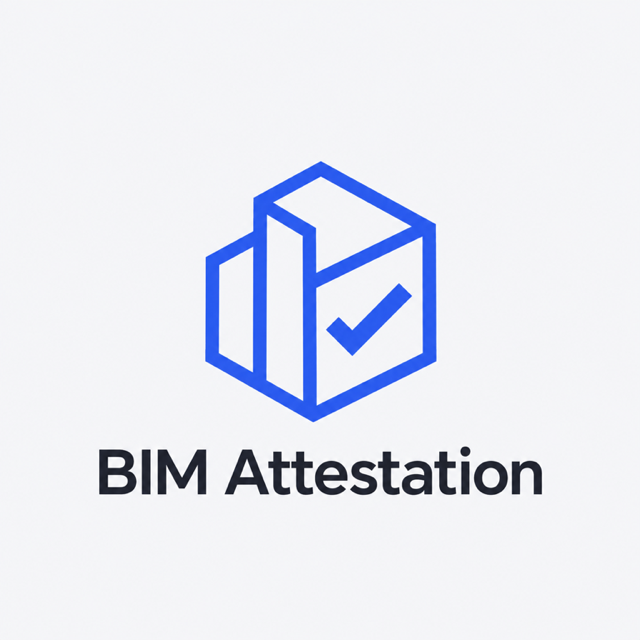

<p align="center">
  
</p>

# QA-Gated Milestone Escrow

The investor cannot change the criteria after the work is done, and the contractor cannot get paid until the criteria are met.

An investor locks payment for a building model (BIM/IFC) in a Solana program, together with a fingerprint (SHA-256) of the acceptance rules. The contractor uploads the model and an automatic quality check runs. If the model passes exactly those rules, the program opens a short dispute window and then pays the contractor. If the deadline passes without a pass, the investor gets the money back.

The oracle cannot pay out alone, the investor cannot block payment alone, and silence never freezes the money.

## The problem

In construction, payment for design work is often late or disputed. "The model does not meet requirements" - but the requirements quietly change during the project, and the contractor does not even know whether the money exists. A bank escrow solves part of this, but it is slow, expensive, and someone still has to decide when to pay.

## What the demo does

1. **Investor** creates a milestone: 1 SOL, a contractor, a deadline, the acceptance rules, an arbiter and a dispute window (20 s in the demo). The money moves into a program account and the rules' fingerprint is stored next to it.
2. **Contractor** uploads `architecture_broken.ifc`. QA says FAIL (two walls without fire rating, one unnamed room). No transaction, the money stays locked.
3. **Attack:** the contractor tries an easier ruleset. The broken model passes it, the oracle asks for approval, and the program rejects it with `RulesetMismatch`.
4. **Contractor** uploads `architecture_valid.ifc`. QA says PASS, the oracle signs an approval, the status becomes Approved and the dispute window starts. Claiming right away is rejected with `ClaimTooEarly`. After the window, Claim pays the contractor.
5. **Attack:** claiming the same milestone again is rejected with `NotApproved`.
6. **Dispute:** a second milestone is approved and the investor disputes it within the window. The arbiter re-runs the check (`reproduce`) and either pays the contractor or refunds the investor. If the arbiter stays silent, the approval stands and the contractor can claim.
7. **Refund:** a third milestone with a 30-second deadline. Nobody delivers, so after the deadline the investor clicks Refund and gets the money back.

Every transaction, including the rejected ones, is a real transaction on the chain with a signature you can open in Solana Explorer. On devnet those links are public (see [Devnet](#devnet)).

## Why Solana

Without Solana the money sits with the investor or a bank, and payment depends on someone's goodwill. With Solana the money is held by a public program that enforces the stored rules, not by the investor and not by us:

- **Frozen criteria.** The rules' fingerprint is stored when the money is locked, together with the contractor, the oracle, the arbiter and the dispute window. The program has no instruction to change any of them.
- **Nobody can hold the money back.** Claiming an approved payment needs nobody's signature. After the window anyone can send it, and it can only go to the stored contractor.
- **Limited trust in the checker.** The oracle (our QA service) can only approve, and only before the deadline and with the stored ruleset. An approval pays nothing by itself: the investor can dispute it within the window and the arbiter decides. If the oracle disappears, the investor gets a refund after the deadline.
- **Limited trust in the arbiter.** The arbiter acts only on a disputed milestone, only within its time, and can only choose between the two stored parties. It must be a different key from the investor, the contractor and the oracle, and the losing side cannot block the decision. If the arbiter stays silent, the oracle's approval stands.
- **Final settlement.** A milestone is paid once or refunded once. The program makes any further payout impossible.

## Limitations

1. **We trust the oracle to run QA honestly, within limits.** The program checks that the oracle claims the stored ruleset, but a dishonest oracle could claim it without running it. The defence: the claim is public and can be checked. The chain stores the hashes of the accepted file, the rules and the QA result, the rules are public, and QA is deterministic, so anyone can re-run it with `app.reproduce`. A wrong approval does not pay immediately, because the investor can dispute it and the arbiter decides. The remaining trust sits with the arbiter, who can only choose between the two stored parties and only when there is a dispute.
2. **Demo keys live in the backend.** The investor, contractor, oracle and arbiter keypairs are held by our server so the demo needs no wallet extension. The payout rules are still enforced on chain: even our backend cannot approve without the oracle key, pay a different wallet, use another ruleset, skip the dispute window or pay twice.
3. **The program is upgradeable.** The reference devnet deployment below has an upgrade authority: the author's devnet wallet `9RecxkvLEH2rnmQb7ThKFRAkQB5bzPg7ygN2PozXSo73` (Solana Explorer shows it as "Upgrade Authority"). The author could replace the program's code, nobody else can. It can be made immutable with `solana program set-upgrade-authority <PROGRAM_ID> --final`. A copy you deploy yourself with `scripts/devnet_deploy.sh` is upgradeable by your deployer key (`.keys/deployer.json`) until you revoke it. The script prints the command.
4. **The oracle carries the liveness risk for the contractor.** If the oracle is down until the deadline, the investor is refunded even if the model was good.
5. **Four distinct keys, not necessarily four distinct people.** The program enforces that the arbiter is not the investor, contractor or oracle key. It cannot know who owns them. The contractor can see the arbiter on chain before starting work.
6. **Payment does not deliver the file.** The chain records the hash of the exact accepted file, so the investor can ask for that file and verify it.

## Run it

Tested with Anchor CLI 1.1.2, Solana/Agave CLI 3.1.10, Rust 1.89 (pinned in `rust-toolchain.toml`), Python 3.13 with [uv](https://docs.astral.sh/uv/), and Node 22 or 25. Verified on macOS arm64 and Linux x86_64. On Windows use WSL2.

```bash
# 1. Build the program (the first build downloads the Solana platform tools)
cd program
anchor build
cargo test            # 29 on-chain tests, about 3 s
cd ..

# 2. Local validator with the program loaded and demo keys funded (keep it running)
scripts/localnet.sh

# 3. Backend (new terminal)
cd backend
uv sync
uv run pytest         # 23 tests: QA + the full scenario against the validator, about 45 s
uv run uvicorn app.main:app --port 8080

# 4. Frontend (new terminal)
cd frontend
npm ci
npm run dev           # open http://localhost:5173
```

Numbered hints in the app guide you through the scenario. You can switch them with "Guide" in the header.

Every start of `scripts/localnet.sh` is a fresh chain. It loads the program at the id it was built with (read from the IDL), so a fresh clone needs no `anchor keys sync`. Demo keypairs are created once in `.keys/` (gitignored).

## Walk through the scenario

| Step | View | Action | Expected |
|---|---|---|---|
| 1 | Investor | *Lock funds* (1 SOL, 5 min, dispute window 20 s, Strict) | Card shows **Open**, the escrow account holds 1 SOL + rent, the arbiter is listed |
| 2 | Contractor | Choose `demo/architecture_broken.ifc`, *Submit for QA* | **FAIL**, 3 violations, no transaction |
| 3 | Contractor | *Get paid with the lenient ruleset* (same file) | Amber "PASS - under rules NOT agreed", **TRANSACTION REJECTED `RulesetMismatch`** |
| 4 | Contractor | Choose `demo/architecture_valid.ifc`, *Submit for QA* | **PASS**, *Approved on chain*, status **Approved**, balance unchanged, countdown |
| 5 | Contractor | *Claim payment* right away | **TRANSACTION REJECTED `ClaimTooEarly`** |
| 6 | Contractor | Wait for "claimable now", *Claim payment* | *Paid*, contractor +1 SOL, status **Released** |
| 7 | Contractor | *Claim payment again* | **TRANSACTION REJECTED `NotApproved`** |
| 8 | Investor, Contractor, Investor | New milestone, submit the valid file, *Dispute* within 20 s | Status **Disputed** |
| 9 | Arbiter | Compare the shown `reproduce` hashes, then *Pay contractor* or *Refund investor* | **Released** (+1 SOL contractor) or **Refunded** (+1 SOL investor) |
| 10 | Investor | Deadline *30 s*, *Lock funds*, wait, *Refund* | Status **Refunded**, investor balance back |

The arbiter has the same time to decide as the dispute window (20 s in the demo). After that the buttons are disabled and the oracle's approval stands.

### Check the oracle yourself

```bash
cd backend
uv run python -m app.reproduce ../demo/architecture_valid.ifc ../rules/ruleset_a_strict.ids
```

It prints PASS or FAIL and three hashes. `asset_hash`, `ruleset_hash` and `result_hash` must equal the values stored in the approved milestone account. They are shown on the milestone card and, for a dispute, in the Arbiter tab.

## Devnet

The same demo runs on Solana devnet, so anyone can open the transactions in the public Explorer.

```bash
scripts/devnet_deploy.sh      # first run: creates .keys/deployer.json, prints its address, stops
# fund that address at https://faucet.solana.com (free devnet test SOL, about 5 SOL), then run it again:
scripts/devnet_deploy.sh      # anchor keys sync + build + deploy (or upgrade) + fund the demo keys
cd backend && CLUSTER=devnet uv run uvicorn app.main:app --port 8080
```

Devnet SOL is free test money with no value. Never send real (mainnet) SOL to these keys. Do not rely on a devnet airdrop during a demo: it is rate-limited (it returned HTTP 429 while this was built), so use the faucet in advance.

The script tops the investor up to 2.5 SOL, which is enough for the UI scenario. The automated test run pays the contractor 2 SOL, which you can send back with `solana transfer <investor address> 1.9 --keypair .keys/contractor.json --url devnet`. A deploy temporarily needs rent for about twice the program size (about 2 SOL for ~190 KB, the upload buffer is refunded). The UI shows a warning when a fee payer runs low (`GET /api/health`), and a transaction dropped for lack of fees returns a readable 504 instead of hanging. `CLUSTER=devnet uv run pytest tests/test_flow_localnet.py` is a manual check against devnet.

### Reference deployment (devnet)

Program `8EYQE68NxVrGT99M24tgLqfeTysuikJGp2CaNgUhsZiS`, built from this code. The full scenario (`tests/test_flow_localnet.py` with `CLUSTER=devnet`, 6 tests) passed against it on 2026-10-11. Every transaction below is finalized on devnet, including the rejected ones:

| Step | Transaction | Result |
|---|---|---|
| Program (deployed and upgraded 2026-10-11) | [explorer](https://explorer.solana.com/address/8EYQE68NxVrGT99M24tgLqfeTysuikJGp2CaNgUhsZiS?cluster=devnet) | - |
| Last upgrade | [explorer](https://explorer.solana.com/tx/5RF92EsAX5YgDes37xM7cmTdfwLk7b1xuMzY2LaDySB3KkbAeuNETt4nUmh6QyPag3Wd8t9XpJUkK4X1n5Br1A5J?cluster=devnet) | ok |
| Lock funds (`create_milestone`) | [explorer](https://explorer.solana.com/tx/3U7hb73tHdzt6FDB9RV9X2nZXLhLwn8U6y1rzHuR6PXQqYAG9AErjus8DnpUgBsvufZRDzDmbADkhbympnfQELwa?cluster=devnet) | ok |
| Lenient-rules attack (`approve`) | [explorer](https://explorer.solana.com/tx/5JVCs5vzTJpJE6UvhDYgLjEBztRbrhe9Bfcn9kCj92WU6AMP2NnJvvKXVwqcPaGosv8fBvD6oCp7nT6CEVKtmvDD?cluster=devnet) | rejected `RulesetMismatch` (6008) |
| Valid model approved (`approve`) | [explorer](https://explorer.solana.com/tx/5BuMJZRfBH1efuFwKHyfnjXdnD9KuQgKwzBCi4We2jg42RhXKMcnmPsbpe53Zq9vL6qBPpzRyN6JkkgqvzCMFirM?cluster=devnet) | ok, no money moved |
| Claim inside the window (`claim`) | [explorer](https://explorer.solana.com/tx/2phcXyHS1EKBxAxw5hNNFGKp9i9FHD3UNwdjWccCyN1L2KqnPXKpKkrtpZ5Rvmdq9iMwPTCPb3bccrGHj32EQsZz?cluster=devnet) | rejected `ClaimTooEarly` (6017) |
| Claim after the window (`claim`) | [explorer](https://explorer.solana.com/tx/3F5yAvWSADQW61PvgbgeUmknMnhW3q1p5ZNuWnqcxVLB5ZhcBrrZMzp6dyk1DpGrYEmdtp15HxKSfwswUndcVr2K?cluster=devnet) | ok, contractor +1 SOL |
| Claim again (`claim`) | [explorer](https://explorer.solana.com/tx/3sKHWxDg7nruoiYM7A4Q3VtfBpKAgcozE5SgqZkbF2wtdDSetbB5jAa31QNKRNgWsVKHEaTkNxjh5h33EL21yFQt?cluster=devnet) | rejected `NotApproved` (6012) |
| Investor disputes (`dispute`) | [explorer](https://explorer.solana.com/tx/2N7mxCMczyLstbgprGzqYuNcyegAVuVAMC8yB7p8k7HDfV7YvmcL5kYtrFkTGhD96njS5c4GhUNq139E36EMoGPb?cluster=devnet) | ok |
| Arbiter pays the contractor (`resolve`) | [explorer](https://explorer.solana.com/tx/9ytLpHQK7e5B7r5hsmZtVhGiRrheefDhZ5DEQhzLJem1vnWr63Cqy7Qae9YfisUSyqLbcTMF7Bh1igF6Pbf65mL?cluster=devnet) | ok, contractor +1 SOL |
| Investor disputes (`dispute`) | [explorer](https://explorer.solana.com/tx/37rABxmkGFzqjD2H15UsgF8wbbbGg8urcp2SRERfWWPGd19xz3kZpNKVZtr1o6MVcbwqWECeGxkhVHECb88gU3ky?cluster=devnet) | ok |
| Arbiter refunds the investor (`resolve`) | [explorer](https://explorer.solana.com/tx/3zsrwbzKp4i5mKAm2CTAGo61r1pvoxv6KWAYxKr5pqzNToQDjKmzZhj4D1wMmg6beizrj46pC6YyRyQ2gZWiepBm?cluster=devnet) | ok, investor +1 SOL |
| Refund before the deadline (`refund`) | [explorer](https://explorer.solana.com/tx/527zLPFdJjqZ18z3LWWXcDCEESk3tJgAgMGt8pswJvkXpELSMxQyH2oqJ39stQDdBE19pMeEpdgiUAtYNuNb4NJ7?cluster=devnet) | rejected `DeadlineNotReached` (6007) |
| Refund after the deadline (`refund`) | [explorer](https://explorer.solana.com/tx/66sKsnDAUHuCNRcPWvase19FMjKT3zU1h6TNZ1PHLRksf49udt3n5gowHRXxf7VTZNK2r7JfE5LCXCATMEPZajcJ?cluster=devnet) | ok, investor +1 SOL |

## How it works

The browser (React) talks to a Python backend. The backend runs the QA check and, only on PASS, signs an approval as the oracle and sends it to the Solana program. The program holds the money and decides who gets paid.

- **On chain** (`program/`, Rust + Anchor): one `Milestone` account per payment holds the lamports and stores investor, contractor, oracle, arbiter, amount, ruleset hash, deadline, dispute window, status and the accepted hashes. There are six instructions:
  - `create_milestone`
  - `approve`: oracle only. Checks oracle, status, deadline and ruleset hash. Moves no money.
  - `dispute`: investor only, within the window.
  - `resolve`: arbiter only, within its time. Pays the contractor or refunds the investor.
  - `claim`: anyone, after the window. Pays the stored contractor.
  - `refund`: investor only, for an open milestone after the deadline.

  Money moves only in `claim`, `resolve` and `refund`, and each sets a final status.
- **Acceptance rules** (`rules/*.ids`) are [buildingSMART IDS](https://www.buildingsmart.org/standards/bsi-standards/information-delivery-specification-ids/) files, the open standard for "what information a model must contain". `ruleset_hash = SHA-256(file bytes)`.
- **QA** (`backend/app/qa.py`): `ifctester` validates the IFC against the IDS. The result (with the file and ruleset hashes, sorted violations, no timestamps) is hashed into `result_hash`.
- **Oracle** (`backend/app/actions.py`): reads the ruleset hash from the chain, loads the matching IDS file, runs QA, and only on PASS sends `approve`. The client never chooses the rules.
- **UI state** is always read from the chain, never from a database.

| Path | What |
|---|---|
| `program/programs/milestone_escrow/src/` | The Solana program (about 300 lines) |
| `program/programs/milestone_escrow/tests/escrow.rs` | 29 tests: happy paths, every error, both sides of every time boundary |
| `backend/app/` | QA engine, oracle, Solana client, API |
| `backend/tests/` | QA tests and the full scenario (undisputed, disputed both ways, refund) on the validator |
| `frontend/src/` | Investor, Contractor and Arbiter views |
| `scripts/` | `localnet.sh` (local chain) and `devnet_deploy.sh` |
| `rules/`, `demo/` | IDS rulesets and demo IFC models (`demo/generate_ifc.py`) |

## Not built yet

USDC instead of SOL, several independent oracles (2-of-3), an on-chain record of FAIL attempts, submission history, many milestones per contract with partial payments, real wallets (Phantom), a hosted deployment, a BIM viewer, CDE integrations.
